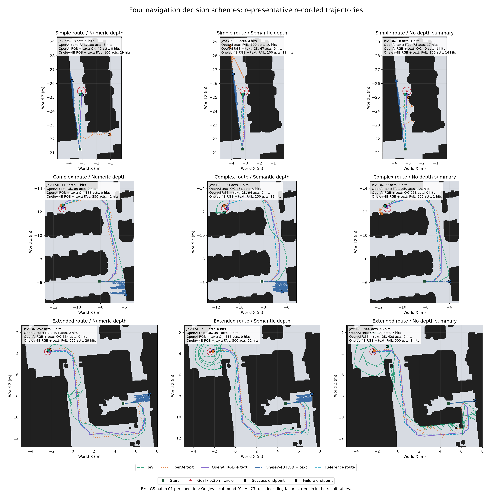

# 固定导航方案：四种决策模型与三种深度输入的对比

本报告在此前 55 轮固定方案对比上，加入 OneJev-4B 本地图文两轮的 18 个任务，合计 **73 轮、36 个条件**。保留成功、提前停止和预算耗尽记录；不以成功与否筛选代表轨迹。当前固定案例中，**OpenAI 图文完成与碰撞表现最好，Jev 简单路线动作效率最好，OpenAI 纯文字在部分复杂条件中有效且高效，OneJev-4B 图文尚未完成任何任务。**

## 实验范围与可比条件

| 路线 | 固定任务 | 原最短距离 m | 参考路线长度 m | 动作预算 |
|---|---|---:|---:|---:|
| 简单路线 | episode-000 | 4.196 | 4.196 | 100 |
| 复杂路线 | turn-000 | 9.798 | 11.711 | 250 |
| 长路线 | extended-000 | 16.323 | 19.613 | 500 |

测试的是**给定参考路线的局部跟随、避障、恢复和停止**。全局参考路线和局部目标由程序提供，不据此评价模型独立全局规划能力。

共同执行七动作：前进、后退各 0.25 m；左转、右转各 15°；抬头、低头、停止。相机高度 1.5 m，初始平视，允许滑动。成功要求模型主动选择 `stop`，且到最终目标的 NavMesh 路径距离 ≤0.30 m。起终点、参考路径、初始朝向/俯仰、路线跟随策略、动作预算和共同几何配置均已核对相同。

| 方案 | 实际响应模型 | 图片输入 | 文字与状态输入 |
|---|---|---|---|
| Jev 文字 | `typesafe/jev-1.13-20260917` | 无；GS/mesh 只用于回放 | 目标、参考路线预览、本体、局部历史，以及对应深度文字 |
| OpenAI 纯文字 | `openai/gpt-6-luna-decisions-20261006` | 无；GS 只用于回放 | 同上 |
| OpenAI 图文 | `openai/gpt-6-luna-decisions-20261006` | 当前带局部目标标记的 GS RGB | 上述文字＋标记元数据与视觉说明 |
| OneJev-4B 图文 | `OmniJev/OneJev-4B`，本地 Qev | 当前带局部目标标记的 GS RGB | 同样的图文逻辑请求；服务端模型模板与实现不同 |

数值与语义都取自当前 mesh 深度的九个前视角度分区。语义距离分档为 very close（≤0.5 m）、close（≤1 m）、moderately near（≤2 m）、far（≤4 m）、very far（>4 m），保留未知、近地面覆盖和移动区域状态。无深度条件仅去除深度文字：**两种图文方案的无深度组仍有 RGB**；两种文字方案没有图像。

首次输入中各方案的非视觉文字事实与动作候选描述一致；OpenAI 图文与 OneJev 图文的首次视觉问题说明也一致。模型接口、服务端模板、请求日期/耗时，以及 Jev 部分记录的回放方式不同，因此这是导航表现对比，不是同硬件推理性能基准或单一 RGB 因果实验。

## 全部记录的成功结果

| 路线 | 深度输入 | Jev | OpenAI 纯文字 | OpenAI 图文 | OneJev-4B 图文 |
|---|---|---:|---:|---:|---:|
| 简单路线 | 数值深度 | 2/2 | 0/2 | 2/2 | 0/2 |
| 简单路线 | 语义深度 | 2/2 | 0/2 | 2/2 | 0/2 |
| 简单路线 | 无深度文字 | 2/2 | 0/2 | 2/2 | 0/2 |
| 复杂路线 | 数值深度 | 1/3 | 2/2 | 2/2 | 0/2 |
| 复杂路线 | 语义深度 | 1/2 | 2/2 | 2/2 | 0/2 |
| 复杂路线 | 无深度文字 | 1/2 | 0/2 | 2/2 | 0/2 |
| 长路线 | 数值深度 | 1/2 | 0/2 | 2/2 | 0/2 |
| 长路线 | 语义深度 | 0/2 | 2/2 | 2/2 | 0/2 |
| 长路线 | 无深度文字 | 0/2 | 2/2 | 2/2 | 0/2 |

| 方案 | 纳入轮数 | 成功 | 成功且零碰撞 | 动作总数 | 碰撞总数 | 无效动作总数 |
|---|---:|---:|---:|---:|---:|---:|
| Jev 文字 | 19 | 10/19 | 7/19 | 3852 | 199 | 148 |
| OpenAI 纯文字 | 18 | 8/18 | 6/18 | 3028 | 290 | 26 |
| OpenAI 图文 | 18 | 18/18 | 16/18 | 3280 | 2 | 2 |
| OneJev-4B 图文 | 18 | 0/18 | 0/18 | 5100 | 422 | 0 |

Jev 复杂数值组保留三轮，其余条件各两轮。整体成功计数的样本权重不同，应优先比较相同路线/深度条件。OpenAI 两类与 OneJev 的对应两轮请求、动作、位姿、结果概率和图像/传输哈希相同，耗时或响应 ID 不同；Jev 重复结果有分歧。重复轨迹不能当成不同随机任务的独立证据。

## 代表轮指标与轨迹对应

每个条件统一选首批 GS 回放记录 `01`，OneJev 选 `local-round-01`，共 **36 条代表轨迹**。下表的成功数来自该条件全部记录；其余指标是所选单轮值，**不是条件均值或两轮总和**。Jev 复杂数值/语义代表轮失败但存在另轮成功，均保留。

累计路程为实际三维位移总和，包括往返；最终距离为 NavMesh 路径距离。碰撞累计每步 `collided`，不等于独立物理接触事件；无效动作按执行层 `valid=false` 计数，也消耗动作预算。两者分别报告。SPL 的基准是原最短距离，失败为零。

### 简单路线

| 深度输入 | 方案 | 全部成功/轮数 | 代表轮结果 | 动作数 | 碰撞 | 无效动作 | 累计路程 m | 最终距离 m | SPL |
|---|---|---:|---|---:|---:|---:|---:|---:|---:|
| 数值深度 | Jev 文字 | 2/2 | [成功](../../runs/jev-simple-rgbgs-numeric-20261008-01/summary.json) | 18 | 0 | 0 | 4.000 | 0.240986 | 1.000 |
| 数值深度 | OpenAI 纯文字 | 0/2 | [失败：预算耗尽](../../runs/openai-decisions-simple-rgbgs-numeric-20261009-01/summary.json) | 100 | 5 | 0 | 5.559 | 4.667272 | 0.000 |
| 数值深度 | OpenAI 图文 | 2/2 | [成功](../../runs/openai-decisions-rgbtarget-simple-rgbgs-numeric-20261009-01/summary.json) | 40 | 0 | 0 | 4.000 | 0.263354 | 1.000 |
| 数值深度 | OneJev-4B 图文 | 0/2 | [失败：预算耗尽](../../runs/onejev-local-rgbtarget-simple-rgbgs-numeric-local-round-01/summary.json) | 100 | 19 | 0 | 24.983 | 1.026274 | 0.000 |
| 语义深度 | Jev 文字 | 2/2 | [成功](../../runs/jev-simple-rgbgs-semantic-20261008-01/summary.json) | 23 | 0 | 0 | 4.000 | 0.240986 | 1.000 |
| 语义深度 | OpenAI 纯文字 | 0/2 | [失败：预算耗尽](../../runs/openai-decisions-simple-rgbgs-semantic-20261009-01/summary.json) | 100 | 10 | 1 | 17.609 | 3.388045 | 0.000 |
| 语义深度 | OpenAI 图文 | 2/2 | [成功](../../runs/openai-decisions-rgbtarget-simple-rgbgs-semantic-20261009-01/summary.json) | 67 | 0 | 0 | 4.000 | 0.269591 | 1.000 |
| 语义深度 | OneJev-4B 图文 | 0/2 | [失败：预算耗尽](../../runs/onejev-local-rgbtarget-simple-rgbgs-semantic-local-round-01/summary.json) | 100 | 19 | 0 | 24.983 | 1.474670 | 0.000 |
| 无深度文字 | Jev 文字 | 2/2 | [成功](../../runs/jev-simple-rgbgs-none-20261008-01/summary.json) | 18 | 1 | 0 | 3.996 | 0.255777 | 1.000 |
| 无深度文字 | OpenAI 纯文字 | 0/2 | [失败：提前停止](../../runs/openai-decisions-simple-rgbgs-none-20261009-01/summary.json) | 75 | 17 | 0 | 6.918 | 0.462650 | 0.000 |
| 无深度文字 | OpenAI 图文 | 2/2 | [成功](../../runs/openai-decisions-rgbtarget-simple-rgbgs-none-20261009-01/summary.json) | 40 | 1 | 0 | 3.996 | 0.250113 | 1.000 |
| 无深度文字 | OneJev-4B 图文 | 0/2 | [失败：预算耗尽](../../runs/onejev-local-rgbtarget-simple-rgbgs-none-local-round-01/summary.json) | 100 | 16 | 0 | 15.486 | 1.068982 | 0.000 |

### 复杂路线

| 深度输入 | 方案 | 全部成功/轮数 | 代表轮结果 | 动作数 | 碰撞 | 无效动作 | 累计路程 m | 最终距离 m | SPL |
|---|---|---:|---|---:|---:|---:|---:|---:|---:|
| 数值深度 | Jev 文字 | 1/3 | [失败：提前停止](../../runs/jev-complex-rgbgs-numeric-20261008-01/summary.json) | 119 | 1 | 9 | 15.228 | 0.303706 | 0.000 |
| 数值深度 | OpenAI 纯文字 | 2/2 | [成功](../../runs/openai-decisions-complex-rgbgs-numeric-20261009-01/summary.json) | 86 | 0 | 0 | 12.000 | 0.278290 | 0.816 |
| 数值深度 | OpenAI 图文 | 2/2 | [成功](../../runs/openai-decisions-rgbtarget-complex-rgbgs-numeric-20261009-01/summary.json) | 166 | 0 | 0 | 12.250 | 0.109957 | 0.800 |
| 数值深度 | OneJev-4B 图文 | 0/2 | [失败：预算耗尽](../../runs/onejev-local-rgbtarget-complex-rgbgs-numeric-local-round-01/summary.json) | 250 | 41 | 0 | 43.248 | 10.929754 | 0.000 |
| 语义深度 | Jev 文字 | 1/2 | [失败：提前停止](../../runs/jev-complex-rgbgs-semantic-20261008-01/summary.json) | 124 | 1 | 6 | 15.901 | 0.351736 | 0.000 |
| 语义深度 | OpenAI 纯文字 | 2/2 | [成功](../../runs/openai-decisions-complex-rgbgs-semantic-20261009-01/summary.json) | 156 | 0 | 9 | 11.750 | 0.241567 | 0.834 |
| 语义深度 | OpenAI 图文 | 2/2 | [成功](../../runs/openai-decisions-rgbtarget-complex-rgbgs-semantic-20261009-01/summary.json) | 94 | 0 | 1 | 12.000 | 0.234743 | 0.816 |
| 语义深度 | OneJev-4B 图文 | 0/2 | [失败：预算耗尽](../../runs/onejev-local-rgbtarget-complex-rgbgs-semantic-local-round-01/summary.json) | 250 | 32 | 0 | 55.494 | 10.550807 | 0.000 |
| 无深度文字 | Jev 文字 | 1/2 | [成功](../../runs/jev-complex-rgbgs-none-20261008-01/summary.json) | 77 | 6 | 0 | 13.430 | 0.294787 | 0.730 |
| 无深度文字 | OpenAI 纯文字 | 0/2 | [失败：预算耗尽](../../runs/openai-decisions-complex-rgbgs-none-20261009-01/summary.json) | 250 | 106 | 0 | 31.390 | 0.689694 | 0.000 |
| 无深度文字 | OpenAI 图文 | 2/2 | [成功](../../runs/openai-decisions-rgbtarget-complex-rgbgs-none-20261009-01/summary.json) | 158 | 0 | 0 | 11.750 | 0.177727 | 0.834 |
| 无深度文字 | OneJev-4B 图文 | 0/2 | [失败：预算耗尽](../../runs/onejev-local-rgbtarget-complex-rgbgs-none-local-round-01/summary.json) | 250 | 1 | 0 | 2.122 | 9.825023 | 0.000 |

### 长路线

| 深度输入 | 方案 | 全部成功/轮数 | 代表轮结果 | 动作数 | 碰撞 | 无效动作 | 累计路程 m | 最终距离 m | SPL |
|---|---|---:|---|---:|---:|---:|---:|---:|---:|
| 数值深度 | Jev 文字 | 1/2 | [成功](../../runs/jev-extended-rgbgs-numeric-20261008-01/summary.json) | 252 | 0 | 4 | 30.000 | 0.161575 | 0.544 |
| 数值深度 | OpenAI 纯文字 | 0/2 | [失败：提前停止](../../runs/openai-decisions-extended-rgbgs-numeric-20261009-01/summary.json) | 194 | 0 | 0 | 20.500 | 0.308222 | 0.000 |
| 数值深度 | OpenAI 图文 | 2/2 | [成功](../../runs/openai-decisions-rgbtarget-extended-rgbgs-numeric-20261009-01/summary.json) | 334 | 0 | 0 | 20.000 | 0.208400 | 0.816 |
| 数值深度 | OneJev-4B 图文 | 0/2 | [失败：预算耗尽](../../runs/onejev-local-rgbtarget-extended-rgbgs-numeric-local-round-01/summary.json) | 500 | 29 | 0 | 37.644 | 16.466812 | 0.000 |
| 语义深度 | Jev 文字 | 0/2 | [失败：预算耗尽](../../runs/jev-extended-rgbgs-semantic-20261008-01/summary.json) | 500 | 0 | 18 | 57.500 | 1.776616 | 0.000 |
| 语义深度 | OpenAI 纯文字 | 2/2 | [成功](../../runs/openai-decisions-extended-rgbgs-semantic-20261009-01/summary.json) | 351 | 0 | 3 | 19.750 | 0.261363 | 0.826 |
| 语义深度 | OpenAI 图文 | 2/2 | [成功](../../runs/openai-decisions-rgbtarget-extended-rgbgs-semantic-20261009-01/summary.json) | 313 | 0 | 0 | 19.750 | 0.258362 | 0.826 |
| 语义深度 | OneJev-4B 图文 | 0/2 | [失败：预算耗尽](../../runs/onejev-local-rgbtarget-extended-rgbgs-semantic-local-round-01/summary.json) | 500 | 51 | 0 | 113.144 | 16.466812 | 0.000 |
| 无深度文字 | Jev 文字 | 0/2 | [失败：预算耗尽](../../runs/jev-extended-rgbgs-none-20261008-01/summary.json) | 500 | 46 | 0 | 84.058 | 1.497800 | 0.000 |
| 无深度文字 | OpenAI 纯文字 | 2/2 | [成功](../../runs/openai-decisions-extended-rgbgs-none-20261009-01/summary.json) | 202 | 7 | 0 | 28.071 | 0.173495 | 0.581 |
| 无深度文字 | OpenAI 图文 | 2/2 | [成功](../../runs/openai-decisions-rgbtarget-extended-rgbgs-none-20261009-01/summary.json) | 428 | 0 | 0 | 19.750 | 0.096026 | 0.826 |
| 无深度文字 | OneJev-4B 图文 | 0/2 | [失败：预算耗尽](../../runs/onejev-local-rgbtarget-extended-rgbgs-none-local-round-01/summary.json) | 500 | 3 | 0 | 6.044 | 15.903454 | 0.000 |

完整每轮指标见 [ALL_RUNS.md](ALL_RUNS.md) 和 [runs.csv](runs.csv)；每条件全部实验的均值与最小/最大范围见 [CONDITION_SUMMARY.md](CONDITION_SUMMARY.md) 和 [aggregate.csv](aggregate.csv)。均值保留失败和预算截断样本，不能据较少动作或较短路程直接推断成功效率更高。

## 轨迹图

主图：行依次为简单、复杂、长路线；列依次为数值、语义、无深度文字。每格叠加四种方案的代表轨迹：**绿色虚线 Jev、橙色点线 OpenAI 纯文字、紫色实线 OpenAI 图文、深蓝点划线 OneJev 图文**，浅蓝虚线为参考路线。



[总图 PNG](trajectories.png) · [PDF](trajectories.pdf) · [SVG](trajectories.svg)

每条路线另给四行三列分图，避免叠加遮挡：行是四种方案，列是三种深度文字。标题列出结果、动作、碰撞、无效动作、路程、最终距离和转向数。

- [简单路线 PNG](trajectories-simple.png) / [PDF](trajectories-simple.pdf)
- [复杂路线 PNG](trajectories-complex.png) / [PDF](trajectories-complex.pdf)
- [长路线 PNG](trajectories-extended.png) / [PDF](trajectories-extended.pdf)

绿色方块为起点，红星为终点，圆点为成功终态，叉为失败终态；分图红叉为发生碰撞后的机器人观察位置，黄三角为无效动作的位置，不是精确物理接触点。0.30 m 圆只表示水平距离，实际成功仍按 NavMesh 路径距离判断。

背景使用原实验保存的 NavMesh 栅格，轨迹连接实际记录的世界 X/Z 坐标；没有平滑、插值或删除重复位置。同一路线所有条件用相同裁剪、等比例坐标和图例。黑色区域不能单独当作完整 mesh 或动态障碍碰撞几何。

原地转向、俯仰和往返重叠在二维位置图中可能不明显。例如 OneJev 复杂无深度连续原地左转 241 次，长无深度连续左转 474 次；OpenAI 图文长无深度 428 步中有 348 次左转。请同时看动作数和动作历史，不能从短轨迹线认定动作效率高。

## 各方案优势与不足

| 方案 | 本批优势 | 本批不足 | 适合保留的对照作用 |
|---|---|---|---|
| Jev 文字 | 简单路线 6/6 成功，数值/无深度代表轮均 18 步；部分复杂成功轮也较快 | 复杂 3/7、长路线 1/6 成功；重复不稳定；超容差停止、绕行、俯仰无效动作和碰撞较多 | 简单路线快速局部跟随的效率基线 |
| OpenAI 纯文字 | 复杂有深度 4/4 成功且零碰撞；复杂数值 86 步；长语义 2/2 成功且每轮零碰撞 | 简单 0/6；复杂无深度每轮 106 次碰撞且失败；长数值在 0.308222 m 提前停止；条件表现差异大 | 分离视觉收益，并观察文字输入下的路径效率与停止边界 |
| OpenAI 图文 | 18/18 成功，16/18 成功且零碰撞；长路线累计路程约 19.75–20 m | 动作效率不总优；复杂数值 166 步，长无深度 428 步；大量单向左转；仍有少量碰撞与俯仰无效动作 | 当前固定案例的完成与安全基线 |
| OneJev-4B 图文 | 本地部署可控；本批请求 P50 约 0.33–0.56 s；多模态传输与服务端加载已确认 | 0/18 成功，422 次碰撞；大量前后往返或原地左转；从未进入成功范围，也未选择右转、俯仰或停止 | 本地轻量模型的失败基线，需先排查输入适配与动作偏置再扩大评测 |

### 按路线与输入解释

**简单路线：Jev 效率最好。** Jev 数值 18 步、语义 23 步，OpenAI 图文分别 40、67 步，均成功。OpenAI 纯文字全失败；无深度在 0.462650 m 提前停止。OneJev 数值/语义分别前进 60/61 次、后退 40/39 次，完全没有转身，累计约 25 m；最近到 0.578 m，仍未达到 0.30 m，不能只归因于不输出停止。

**复杂路线：OpenAI 图文覆盖更稳定，纯文字数值更省动作。** OpenAI 纯文字数值 86 步零碰撞成功，图文数值 166 步；语义则图文 94 步少于纯文字 156 步。Jev 数值/语义首轮在 0.303706/0.351736 m 提前停止，另有成功记录。OneJev 数值/语义走 43.248/55.494 m 后剩余距离比起点还大；无深度末尾连续左转 241 次，主要没有平移进展。

**长路线：OpenAI 图文完成与路径效率最好，动作效率仍有损失。** 三种输入均成功且每轮零碰撞，路径接近给定参考路线长度。纯文字长语义也成功且零碰撞；长数值仅超成功阈值约 8 mm，失败主要是停止边界，不能说全程跟随无效。Jev 长数值只有一轮成功并走 30 m，语义/无深度全失败。OneJev 语义走 113.144 m 后仍距终点 16.467 m；数值末尾连续左转 324 次，无深度 474 次。

**无深度文字不等于无环境感知。** OpenAI 图文无深度 6/6 成功，而 OneJev 图文无深度 0/6；仅有图像输入并不保证模型能完成跟随。OneJev 复杂/长无深度碰撞较少，伴随大量原地旋转，不能解释为避障能力更强。

**语义与数值仍没有统一优胜者。** 优势随模型和路线变化。OpenAI 图文复杂/长语义动作更少，简单数值更少；纯文字 OpenAI 长语义完成而数值略早停止；Jev 长路线只有数值一次成功；OneJev 两类均失败，语义并未解决往返问题。每条件仅 2–3 轮，且多组重复轨迹完全相同，不能推出普遍排名。

### 图文输入与失败机制的证据范围

OpenAI 图文共 3,280 次图片请求，其中 406 次（12.4%）目标投影在画面内；OneJev 共 5,100 次图片请求，仅 4 次（0.078%）在画面内，其余 5,096 次是画面边缘箭头。两者使用相同标记生成逻辑，比例差异伴随不同执行轨迹与俯仰选择，不能据此推断某一模型收到了更差的标记生成器。

OneJev 所有请求时俯仰均为 0°，动作只出现前进、后退、左转，未选择右转、抬头、低头或停止。两轮动作与概率完全一致，本地 Qev 的选择输出取最高概率候选。本批已经确认真实图像随请求发送并经过服务端多模态处理，但不能证明模型有效利用视觉。

OneJev 的失败现象提示后续应区分模型能力、动作标签/候选顺序偏置、服务端模板适配，以及目标可见性。当前日志没有受控对照能确定其中哪一项是根因；本报告不据此宣布权重或接口存在故障。OpenAI 图文的改善也同时包含 RGB、虚拟目标标记与视觉提示词，没有无标记 RGB 的单独对照，不能把收益全部归因于 RGB。

### 调用延迟

| 方案 | 每轮请求 P50 范围 s |
|---|---:|
| Jev 文字 | 0.521–1.630 |
| OpenAI 纯文字 | 1.314–1.497 |
| OpenAI 图文 | 1.934–2.437 |
| OneJev-4B 图文 | 0.326–0.560 |

这是实际请求延迟，云服务包含网络与可能的重试，本地与云端硬件/时间不同，不能作为严格推理速度排名。OneJev 单步调用较快，却未完成任务；OpenAI 图文较慢且转向多，完整任务时间仍需结合动作数判断。

## 判断与完整数据

当前固定方案下，保留 OpenAI 图文作为完成与安全基线，Jev 作为简单路线动作效率对照，OpenAI 纯文字作为视觉与深度消融对照。OneJev 本批应作为待诊断的本地模型基线，现阶段尚不适合承担可靠导航控制。以上只针对三个固定案例，不是跨场景模型能力排名，也不能由两轮相同轨迹推断随机任务稳定性。

保留此前已纳入的全部 55 轮，并明确追加 `local-round-01/02` 的 18 轮。没有再次扫描扩入未请求的新实验，没有调用模型、修改提示词/导航源码或改写历史结果。

- [73 轮逐轮指标](runs.csv) / [逐轮全文表](ALL_RUNS.md)
- [36 条件均值与范围](aggregate.csv) / [条件全文表](CONDITION_SUMMARY.md)
- [36 条代表记录](representatives.csv) / [四方案总计](totals.csv)
- [轨迹原始坐标](trajectory-points.csv) / [绘图来源与坐标哈希](plot-provenance.json)
- [复核数据与源哈希](audit.json) / [完整性检查结果](validation.json)
- [指标复核脚本](audit.py) / [绘图脚本](plot.py) / [报告脚本](report.py) / [完整性检查脚本](verify.py)
- [旧方案排除记录](excluded.csv)：沿用此前 55 轮报告的排除口径；本次新增的 18 轮全部保留。

本次重新计算 **15,260 个动作**后的 NavMesh 路径距离、累计位移、碰撞/无效次数、成功与 SPL、延迟分位数；重新校验 8,380 次图文请求的 JPEG、目标投影和传输哈希，其中 OneJev 每次响应均确认一张图片。绘图只使用选中记录的实际位姿和原始 NavMesh 背景；原始证据在结束时再次验哈希。

此前代码哈希与当前版本存在部分差异（OneJev 接入期间的 `jev.py`、`rgb_input.py`、`run.py`），已在审计中区分历史代码快照与不可改写的实验记录；本次冻结的是保存的请求和执行证据，没有用当前代码重新生成旧模型行为。

复现核查与绘图，不发送模型请求或启动 GPU 渲染：

```bash
conda activate habitat-gs
REPORT=reports/four-model-navigation-comparison-20261012-01
OUT=/tmp/four-model-navigation-recheck
python "$REPORT/audit.py" "$OUT"
python "$REPORT/plot.py" "$OUT"
python "$REPORT/report.py" "$OUT"
python "$REPORT/verify.py" "$OUT"
```

来源：[此前三方案对比](../model-navigation-comparison-20261010-01/README.md)、[OneJev 两轮审核](../onejev-local-rounds-audit-01/README.md)。
