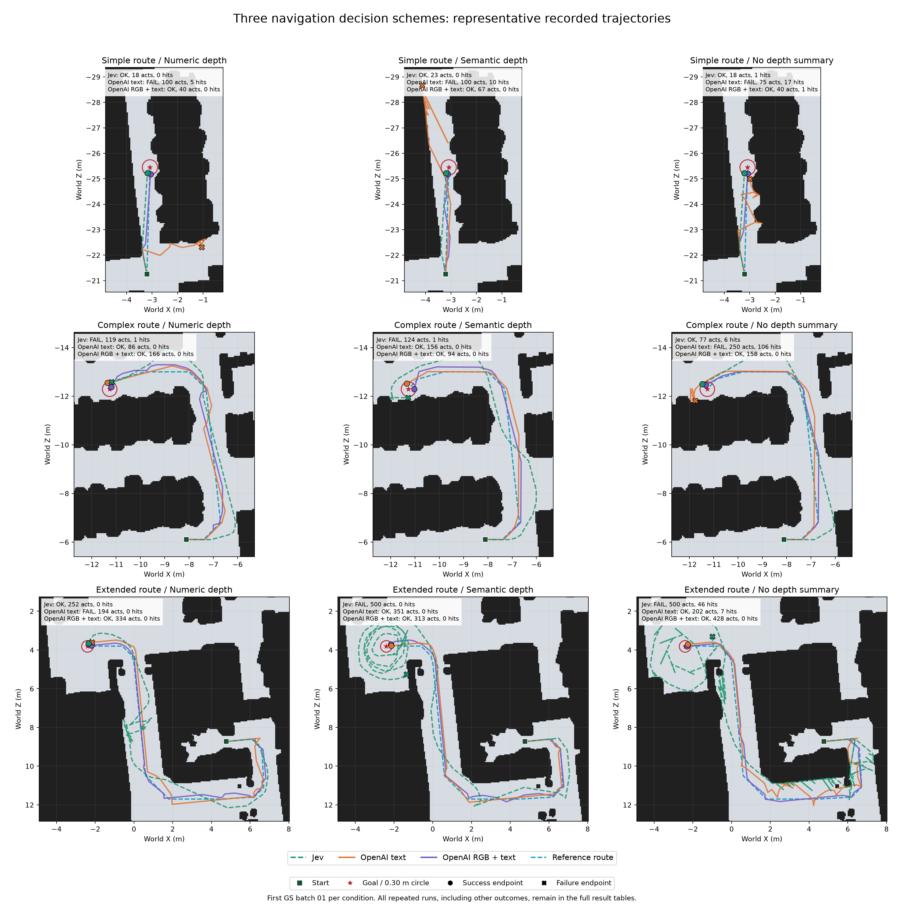

# 固定导航方案：Jev、OpenAI 纯文字、OpenAI 图文综合对比（2026-10-10）

**当前三个固定任务下，OpenAI 图文的完成与碰撞表现最好；Jev 在简单路线的动作效率最好；OpenAI 纯文字在复杂数值条件下兼具成功和较低动作成本。图文方案仍有大量原地左转，Jev 则在复杂/长路线出现重复不稳定、绕行和停止边界失败。**

范围：固定七动作 v5 路径辅助跟随策略，三种深度条件、三条固定路线，纳入全部可比完成记录 **55轮**：Jev19轮、OpenAI纯文字18轮、OpenAI图文18轮。保留成功、提前停止和预算耗尽；排除不同动作/策略、初始姿态/路线、预算以及未完整运行的记录。没有改写早期失败或挑选成功样本计算成功率。

## 任务与输入

| 路线 | 固定任务 | 原最短距离 m | 参考路线长度 m | 动作预算 |
|---|---|---:|---:|---:|
| 简单 | debug-10 / episode-000 | 4.196 | 4.196 | 100 |
| 复杂 | challenge-clearance-aligned / turn-000 | 9.798 | 11.711 | 250 |
| 长路线 | extended-clearance-aligned / extended-000 | 16.323 | 19.613 | 500 |

- 上层给定参考路线和局部目标，程序转换为身体相对坐标；本实验测试局部跟随、避障、恢复和停止，未测试模型独立全局寻路。
- 共同动作：前进、后退（均0.25 m）、左转、右转（均15°）、抬头、低头、停止。相机高度1.5 m、初始平视；停止成功要求模型主动stop且NavMesh路径距离≤0.30 m。
- 数值/语义条件都来自当前mesh深度，保留同样九个前视方向分区，改变其文字编码；无深度仍有参考路线、目标、本体和自身动作反馈。
- 数值输入包含障碍水平距离、观测范围和移动区域状态；语义输入把距离映射为 very close（≤0.5 m）、close（≤1 m）、moderately near（≤2 m）、far（≤4 m）、very far（>4 m），并保留未知、近地面可见性和移动区域的语义状态。两者几何来源相同，但量化后的信息精度不同。
- Jev与OpenAI纯文字不发送RGB；OpenAI图文同时增加当前GS RGB、当前航点圆环/画面外箭头、标记元数据及视觉提示词。“图文无深度”仍有视觉，不能等同于完全无环境观察。
- 实际响应版本：Jev为 `typesafe/jev-1.13-20260917`，OpenAI两类为 `openai/gpt-6-luna-decisions-20261006`。

## 指标口径

- 动作数包括移动、转向、俯仰、停止和无效尝试；累计路程是各次执行后的实际三维位移之和，不是动作数乘0.25 m。
- 碰撞次数累计Habitat每步返回的 collided 标志，反映移动过滤后的反馈；不等于精确mesh接触检测，也不代表发生了多少次独立碰撞事件。
- 无效动作包括动作不在允许范围或俯仰超限。本批候选动作固定，实际无效主要来自俯仰超限；无效尝试消耗预算。
- 最终距离是终态到终点的NavMesh路径距离。提前stop时仍大于0.30 m记失败；没有stop即使曾进入范围也不算成功。SPL以原最短距离为基准，失败为0。

## 全部记录的成功数

| 路线 | 输入 | Jev成功/轮数 | OpenAI纯文字成功/轮数 | OpenAI图文成功/轮数 |
|---|---|---:|---:|---:|
| 简单路线 | 数值深度 | 2/2 | 0/2 | 2/2 |
| 简单路线 | 语义深度 | 2/2 | 0/2 | 2/2 |
| 简单路线 | 无深度 | 2/2 | 0/2 | 2/2 |
| 复杂路线 | 数值深度 | 1/3 | 2/2 | 2/2 |
| 复杂路线 | 语义深度 | 1/2 | 2/2 | 2/2 |
| 复杂路线 | 无深度 | 1/2 | 0/2 | 2/2 |
| 长路线 | 数值深度 | 1/2 | 0/2 | 2/2 |
| 长路线 | 语义深度 | 0/2 | 2/2 | 2/2 |
| 长路线 | 无深度 | 0/2 | 2/2 | 2/2 |

| 方案 | 纳入轮数 | 成功 | 成功且零碰撞 | 动作总数 | 碰撞总数 | 无效动作总数 |
|---|---:|---:|---:|---:|---:|---:|
| Jev 文字决策 | 19 | 10/19 | 7/19 | 3852 | 199 | 148 |
| OpenAI 纯文字 | 18 | 8/18 | 6/18 | 3028 | 290 | 26 |
| OpenAI 图文 | 18 | 18/18 | 16/18 | 3280 | 2 | 2 |

Jev复杂数值有3轮，其余各组合均2轮，整体计数的样本权重不同；应优先看逐条件表。每类只有一个固定任务，这些分数不代表跨场景导航成功率。OpenAI各条件的两轮请求/动作/轨迹/答案概率完全相同，但响应ID不同；Jev重复表现存在分歧。

## 与轨迹图对应的代表轮指标

以下27条代表轮统一选各条件第一批GS记录01，**选择不依赖成功与否**。成功数仍来自该条件全部记录；动作/碰撞/无效/路程/最终距离/SPL是所选单轮的数值，不是条件均值。原始目录可以点击结果列。尤其Jev复杂数值/语义的所选GS轮失败，但另有成功记录，不能据图认定该条件全部失败。

### 简单路线

| 输入 | 方案 | 全部成功/轮数 | 代表轮结果 | 动作数 | 碰撞 | 无效动作 | 累计路程 m | 最终距离 m | SPL |
|---|---|---:|---|---:|---:|---:|---:|---:|---:|
| 数值深度 | Jev 文字决策 | 2/2 | [成功](../../runs/jev-simple-rgbgs-numeric-20261008-01/summary.json) | 18 | 0 | 0 | 4.000 | 0.240986 | 1.000 |
| 数值深度 | OpenAI 纯文字 | 0/2 | [失败：预算耗尽](../../runs/openai-decisions-simple-rgbgs-numeric-20261009-01/summary.json) | 100 | 5 | 0 | 5.559 | 4.667272 | 0.000 |
| 数值深度 | OpenAI 图文 | 2/2 | [成功](../../runs/openai-decisions-rgbtarget-simple-rgbgs-numeric-20261009-01/summary.json) | 40 | 0 | 0 | 4.000 | 0.263354 | 1.000 |
| 语义深度 | Jev 文字决策 | 2/2 | [成功](../../runs/jev-simple-rgbgs-semantic-20261008-01/summary.json) | 23 | 0 | 0 | 4.000 | 0.240986 | 1.000 |
| 语义深度 | OpenAI 纯文字 | 0/2 | [失败：预算耗尽](../../runs/openai-decisions-simple-rgbgs-semantic-20261009-01/summary.json) | 100 | 10 | 1 | 17.609 | 3.388045 | 0.000 |
| 语义深度 | OpenAI 图文 | 2/2 | [成功](../../runs/openai-decisions-rgbtarget-simple-rgbgs-semantic-20261009-01/summary.json) | 67 | 0 | 0 | 4.000 | 0.269591 | 1.000 |
| 无深度 | Jev 文字决策 | 2/2 | [成功](../../runs/jev-simple-rgbgs-none-20261008-01/summary.json) | 18 | 1 | 0 | 3.996 | 0.255777 | 1.000 |
| 无深度 | OpenAI 纯文字 | 0/2 | [失败：提前停止](../../runs/openai-decisions-simple-rgbgs-none-20261009-01/summary.json) | 75 | 17 | 0 | 6.918 | 0.462650 | 0.000 |
| 无深度 | OpenAI 图文 | 2/2 | [成功](../../runs/openai-decisions-rgbtarget-simple-rgbgs-none-20261009-01/summary.json) | 40 | 1 | 0 | 3.996 | 0.250113 | 1.000 |

### 复杂路线

| 输入 | 方案 | 全部成功/轮数 | 代表轮结果 | 动作数 | 碰撞 | 无效动作 | 累计路程 m | 最终距离 m | SPL |
|---|---|---:|---|---:|---:|---:|---:|---:|---:|
| 数值深度 | Jev 文字决策 | 1/3 | [失败：提前停止](../../runs/jev-complex-rgbgs-numeric-20261008-01/summary.json) | 119 | 1 | 9 | 15.228 | 0.303706 | 0.000 |
| 数值深度 | OpenAI 纯文字 | 2/2 | [成功](../../runs/openai-decisions-complex-rgbgs-numeric-20261009-01/summary.json) | 86 | 0 | 0 | 12.000 | 0.278290 | 0.816 |
| 数值深度 | OpenAI 图文 | 2/2 | [成功](../../runs/openai-decisions-rgbtarget-complex-rgbgs-numeric-20261009-01/summary.json) | 166 | 0 | 0 | 12.250 | 0.109957 | 0.800 |
| 语义深度 | Jev 文字决策 | 1/2 | [失败：提前停止](../../runs/jev-complex-rgbgs-semantic-20261008-01/summary.json) | 124 | 1 | 6 | 15.901 | 0.351736 | 0.000 |
| 语义深度 | OpenAI 纯文字 | 2/2 | [成功](../../runs/openai-decisions-complex-rgbgs-semantic-20261009-01/summary.json) | 156 | 0 | 9 | 11.750 | 0.241567 | 0.834 |
| 语义深度 | OpenAI 图文 | 2/2 | [成功](../../runs/openai-decisions-rgbtarget-complex-rgbgs-semantic-20261009-01/summary.json) | 94 | 0 | 1 | 12.000 | 0.234743 | 0.816 |
| 无深度 | Jev 文字决策 | 1/2 | [成功](../../runs/jev-complex-rgbgs-none-20261008-01/summary.json) | 77 | 6 | 0 | 13.430 | 0.294787 | 0.730 |
| 无深度 | OpenAI 纯文字 | 0/2 | [失败：预算耗尽](../../runs/openai-decisions-complex-rgbgs-none-20261009-01/summary.json) | 250 | 106 | 0 | 31.390 | 0.689694 | 0.000 |
| 无深度 | OpenAI 图文 | 2/2 | [成功](../../runs/openai-decisions-rgbtarget-complex-rgbgs-none-20261009-01/summary.json) | 158 | 0 | 0 | 11.750 | 0.177727 | 0.834 |

### 长路线

| 输入 | 方案 | 全部成功/轮数 | 代表轮结果 | 动作数 | 碰撞 | 无效动作 | 累计路程 m | 最终距离 m | SPL |
|---|---|---:|---|---:|---:|---:|---:|---:|---:|
| 数值深度 | Jev 文字决策 | 1/2 | [成功](../../runs/jev-extended-rgbgs-numeric-20261008-01/summary.json) | 252 | 0 | 4 | 30.000 | 0.161575 | 0.544 |
| 数值深度 | OpenAI 纯文字 | 0/2 | [失败：提前停止](../../runs/openai-decisions-extended-rgbgs-numeric-20261009-01/summary.json) | 194 | 0 | 0 | 20.500 | 0.308222 | 0.000 |
| 数值深度 | OpenAI 图文 | 2/2 | [成功](../../runs/openai-decisions-rgbtarget-extended-rgbgs-numeric-20261009-01/summary.json) | 334 | 0 | 0 | 20.000 | 0.208400 | 0.816 |
| 语义深度 | Jev 文字决策 | 0/2 | [失败：预算耗尽](../../runs/jev-extended-rgbgs-semantic-20261008-01/summary.json) | 500 | 0 | 18 | 57.500 | 1.776616 | 0.000 |
| 语义深度 | OpenAI 纯文字 | 2/2 | [成功](../../runs/openai-decisions-extended-rgbgs-semantic-20261009-01/summary.json) | 351 | 0 | 3 | 19.750 | 0.261363 | 0.826 |
| 语义深度 | OpenAI 图文 | 2/2 | [成功](../../runs/openai-decisions-rgbtarget-extended-rgbgs-semantic-20261009-01/summary.json) | 313 | 0 | 0 | 19.750 | 0.258362 | 0.826 |
| 无深度 | Jev 文字决策 | 0/2 | [失败：预算耗尽](../../runs/jev-extended-rgbgs-none-20261008-01/summary.json) | 500 | 46 | 0 | 84.058 | 1.497800 | 0.000 |
| 无深度 | OpenAI 纯文字 | 2/2 | [成功](../../runs/openai-decisions-extended-rgbgs-none-20261009-01/summary.json) | 202 | 7 | 0 | 28.071 | 0.173495 | 0.581 |
| 无深度 | OpenAI 图文 | 2/2 | [成功](../../runs/openai-decisions-rgbtarget-extended-rgbgs-none-20261009-01/summary.json) | 428 | 0 | 0 | 19.750 | 0.096026 | 0.826 |

完整逐轮指标另见 [ALL_RUNS.md](ALL_RUNS.md) 和 [runs.csv](runs.csv)，包含全部55轮及最小距离、SPL、模型调用延迟。各组合均值和范围见 [aggregate.csv](aggregate.csv)，保留失败截断样本，均值不等同于成功路径效率。

## 轨迹图

主图每一行依次为简单、复杂、长路线；每一列依次为数值、语义、无深度。每格叠加三类模型的代表轨迹：绿色虚线Jev、橙色OpenAI纯文字、紫色OpenAI图文；蓝色虚线为给定参考路线。

[主图PNG](trajectories.png) · [矢量PDF](trajectories.pdf) · [SVG](trajectories.svg)

为避免重叠遮挡，另提供每条路线的九宫格：**行是Jev／OpenAI纯文字／OpenAI图文，列是数值／语义／无深度**。标题保留结果、动作、碰撞、无效、路程与最终距离；红叉表示碰撞后观察的机器人位置，黄三角表示无效动作时位置。

- [简单路线PNG](trajectories-simple.png) / [PDF](trajectories-simple.pdf)
- [复杂路线PNG](trajectories-complex.png) / [PDF](trajectories-complex.pdf)
- [长路线PNG](trajectories-extended.png) / [PDF](trajectories-extended.pdf)

地图沿用原实验保存的NavMesh俯视图，用实际记录的世界X/Z位姿连接轨迹；未重新渲染、平滑、插值或删除重复位置。相同路线使用同样裁剪和等比例坐标。绿色方块为起点，红星为终点，彩色圆点为成功终态、叉为失败终态。终点0.30 m圆仅为水平距离视觉提示，成功判定仍用NavMesh路径距离。碰撞位置不是精确物理接触点。

原地旋转/观察不会延长图上的位置轨迹，因此“贴着路线的一条短线”不一定动作少。例如OpenAI图文长无深度428步中348次左转，曾连续116步原地左转；完整动作数和最长停留段保存在audit.json。

## 各方案优劣

| 方案 | 本批优势 | 本批不足 | 判断范围 |
|---|---|---|---|
| Jev文字决策 | 简单路线6/6成功；数值18步、语义23步，明显少于图文40/67步；复杂成功样本数值86步、语义76步且零碰撞 | 复杂仅3/7成功，长路线仅1/6；有超容差停止、终点绕行、偏离参考路线和重复超俯仰动作；长无深度158次碰撞 | 简单跟随效率好，复杂/长路线的恢复与最终接近不稳定 |
| OpenAI纯文字 | 复杂有深度4/4成功且零碰撞；复杂数值86步，少于图文166步；长语义2/2成功、每轮零碰撞且约19.75 m | 简单6轮全失败；复杂无深度两轮各106次碰撞且失败；长数值两轮在0.308222 m提前停止；同样有偏左转 | 部分复杂跟随有效，但目标跟随/恢复和停止边界表现不统一 |
| OpenAI图文 | 所有条件18/18成功，16/18零碰撞成功；进入容差后均下一动作停止；复杂无深度零碰撞，长路线实际路程约19.75–20.00 m | 全部3280动作中的原地转向很多；复杂数值166步、长无深度428步；简单无深度每轮仍碰撞1次，复杂语义每轮1次超限低头；图像请求通常更慢 | 当前固定案例的完成与安全最好，仍需改进动作效率 |

### 按路线解释

- **简单路线：Jev更省动作。** Jev数值18步、语义23步；OpenAI图文为40/67步。纯文字OpenAI无法稳定完成，失败不只是停止：数值从初期约3.227 m继续偏离，语义接近至0.333 m后远离，无深度在0.463 m提前停止。
- **复杂路线：纯文字数值效率高，图文条件覆盖好。** OpenAI纯文字数值86步零碰撞，图文数值166步零碰撞；语义则图文94步优于纯文字156步。Jev的另两个mesh回放成功样本为数值86步／13.750 m／0碰撞／1无效、语义76步／13.000 m／0碰撞／0无效，但同条件GS记录分别在0.303706／0.351736 m提前停止。保留这些失败才能看见稳定性问题。
- **长路线：图文路径更短、完成更稳定。** Jev数值成功轮走30.000 m，语义失败轮走55.000–57.500 m，无深度失败轮约84 m；OpenAI图文三模式都成功，约19.75–20 m。OpenAI纯文字长语义同样成功且零碰撞，纯文字长数值虽失败却已基本完成路径，只差停止边界，不能说其全程跟随都失败。
- **无深度：图文的视觉不能忽略。** Jev和OpenAI纯文字都只有路线/目标/反馈；图文还看RGB和标记。复杂无深度纯文字OpenAI每轮106次碰撞、Jev成功轮6次碰撞，图文0次；长无深度图文虽零碰撞成功，却用428步，而纯文字OpenAI202步成功但7次碰撞、路径28.071 m。安全与效率需要分别报告。
- **语义与数值没有统一优胜者。** Jev简单数值更快，复杂语义有较快成功样本，长路线只有数值一次成功；纯文字OpenAI长语义优于数值的停止结果；图文复杂与长语义动作更少，简单数值更少。每格只有2–3轮，不能推出语义普遍优于数值。

### 延迟与图文效果的解释

记录中各轮API请求P50范围：Jev约0.52–1.63 s，OpenAI纯文字1.31–1.50 s，OpenAI图文1.93–2.44 s。包含网络/服务重试，模型请求日期和GS/mesh回放条件不同，不能当成严格硬件性能基准；精确逐轮值在CSV。低路程也不一定低动作成本，原地转向和图像调用会增加时间。

图文输入的航点圆环只有12.4%的请求落在图像内，其余大多是画面外/身后箭头；成功不能证明模型持续看着地面圆环行驶。当前图文组合同时改变RGB、虚拟标记和提示词／state编码，没有RGB不带标记的单独对照，因此不能把全部改善单独归因于RGB。

## 结论与后续关注

当前应保留图文方案作为完成与安全基线；若重点是简单任务的快速动作控制，Jev仍有优势；复杂数值任务的纯文字OpenAI值得保留作为效率对照。下一步最有价值的是扩大固定策略下的起终点/朝向样本，并针对图文方案的单向反复转圈做单独对照。不要同时修改路线、俯仰和动作控制，否则难以定位收益来源。

这些结论针对三条固定路线，不是跨环境排名。失败受预算/提前停止截断，不能只按动作少或路程短判断能力；零碰撞失败也不能记作避障导航成功。本次没有重跑模型、修改提示词或导航代码。

## 完整数据与核查

[55轮逐轮指标](runs.csv) · [全文逐轮表](ALL_RUNS.md) · [27组合聚合与范围](aggregate.csv) · [27条代表记录](representatives.csv) · [原始轨迹坐标](trajectory-points.csv) · [审计数据/源哈希](audit.json) · [绘图来源](plot-provenance.json) · [排除记录](excluded.csv) · [复核脚本](audit.py) · [绘图脚本](plot.py) · [完整性复核脚本](verify.py) · [复核结果](validation.json)

- 重新计算全部10,160个动作后的NavMesh目标距离，并复核路径长度、动作/碰撞/无效计数、成功与SPL、日志步序和帧间连续性。
- 三类方案的初始文字事实和候选动作描述匹配；非视觉组提示词匹配。任务、参考路径、初始身体/相机姿态及共同几何参数相同；有效差异为模型、深度编码及对应说明、视觉输入及对应说明、服务时间/GPU/回放方式。
- 按整个runs目录扫描，纳入55轮，排除17轮不符合固定方案或未完整的模型记录。原Jev历史失败保留，图文五步联调排除。
- 视觉原审计的3280幅JPEG和wire哈希校验已完成，本次重新核对包括输入JPEG、源码和原始日志在内的3455个已有来源哈希未变化。
- 27条图示轨迹共4812幅记录观察（包括终态），点数和起终态均逐一与日志核查；选择不依赖结果，所有其它轮次仍在全文指标中。
- 背景是已存NavMesh栅格，图中的黑色区域不能独立解释为完整mesh或动态物体碰撞几何。未调用API、未加载渲染器、未使用GPU。

历史来源：[Jev三路线汇总](../route-ablation-summary-20261008-01/README.md)、[OpenAI纯文字审计](../openai-ablation-audit-20261009-01/README.md)、[OpenAI图文审计](../openai-rgb-ablation-audit-20261010-01/README.md)。
