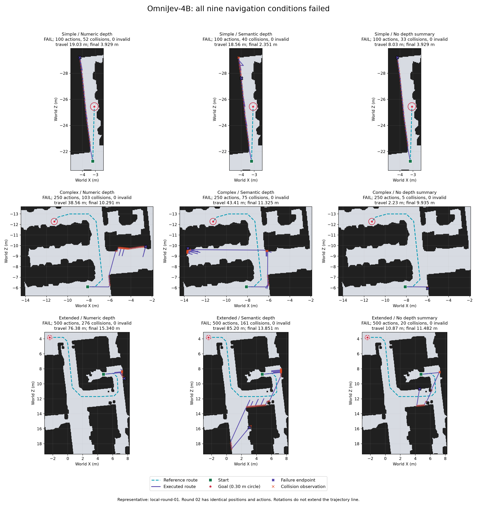
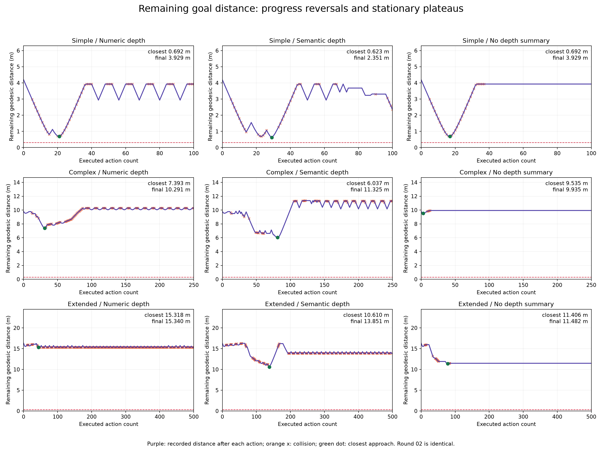

# OmniJev-4B 两轮图文导航审核：18 轮均失败，主要表现为往返碰撞和转向循环

审核 `local-round-01`、`local-round-02` 的 18 个任务：三条固定路线 × 三种深度文字输入 × 两轮。**0/18 成功，18/18 均为动作预算耗尽，全部未进入 0.30 m 到达范围。**核验了 5,100 次实际图文决策；当前记录没有服务故障、重试或动作集合外输出。

两轮对应条件的动作、位姿、图片、请求、原生提示词哈希和概率逐步完全一致。下面的九条件表列的是每一轮的指标，两轮同值；它们不是两轮相加。原始逐轮结果见 [runs.csv](runs.csv)，均值与范围见 [aggregate.csv](aggregate.csv)。

## 三条路线与三种深度输入的结果

| 路线 | 深度文字 | 成功数 | 动作/轮 | 碰撞/轮 | 无效/轮 | 累计路程 m/轮 | 最终距离 m | 最近距离 m |
|---|---|---:|---:|---:|---:|---:|---:|---:|
| 简单 | 数值 | 0/2 | 100 | 52 | 0 | 19.028 | 3.929 | 0.692 |
| 简单 | 语义 | 0/2 | 100 | 40 | 0 | 18.556 | 2.351 | 0.623 |
| 简单 | 无深度文字 | 0/2 | 100 | 33 | 0 | 8.028 | 3.929 | 0.692 |
| 复杂 | 数值 | 0/2 | 250 | 103 | 0 | 38.560 | 10.291 | 7.393 |
| 复杂 | 语义 | 0/2 | 250 | 75 | 0 | 43.406 | 11.325 | 6.037 |
| 复杂 | 无深度文字 | 0/2 | 250 | 5 | 0 | 2.235 | 9.935 | 9.535 |
| 长路线 | 数值 | 0/2 | 500 | 276 | 0 | 76.377 | 15.340 | 15.318 |
| 长路线 | 语义 | 0/2 | 500 | 161 | 0 | 85.204 | 13.851 | 10.610 |
| 长路线 | 无深度文字 | 0/2 | 500 | 20 | 0 | 10.866 | 11.482 | 11.406 |

初始 NavMesh 最短距离分别为简单 4.196 m、复杂 9.798 m、长路线 16.323 m。动作预算分别为 100、250、500；成功要求模型主动输出 `stop`，并且执行终态的 NavMesh 最短距离 ≤0.30 m。全部 SPL=0、零碰撞成功=0。累计路程为实际三维位移总和，包含滑动、后退和往返，不等于向终点的进展。

18 轮合计 5,100 次动作、1,530 次碰撞、0 次无效动作，累计移动 604.517 m。碰撞比例为 30.0%（碰撞动作数/全部动作数，包含转向等动作）；本实验的碰撞是 Habitat NavMesh 移动过滤反馈，不是 Bullet 刚体接触。866 次碰撞伴随大于 0.1 mm 的位移，664 次碰撞没有超过这个位移阈值，因此不能将每次碰撞都解释为完全卡住。动作有效性与碰撞是两个独立指标。

## 多模态与深度输入确实进入了当前服务

每个请求同时核对了：当前保存的 640×480 JPEG 字节与 SHA256；独立重建的内联图片 HTTP 请求哈希与客户端/记录器哈希；服务端原生问题哈希与完整 `NAVIGATION_STATE_JSON` 状态；服务返回的一张图片回执及原 JPEG 哈希。5,100 次全部匹配。

实际模型为 `tinnel123/OmniJev` v1.1，底座为固定 revision 的原始 Qwen3.5-4B，BF16 底座、FP32 决策头；服务为 `http://127.0.0.1:8012/v1/systemone`，原生 branch 推理、SDPA、缓存 1 张图、无云端回退。部署清单/桥接代码/固定上游源码与实际记录相符，候选均为前进、后退、左右转、上下俯仰、停止这七项。

数值组的九角度区域深度摘要保留；语义组逐步与数值调试摘要转换一致；none 组没有深度字段，仍有 RGB、目标/路径文字、机器人状态和最近动作/运动摘要。因此“无深度”不是“无视觉”。服务回执和代码路径证明媒体和状态被处理，但不能证明模型有效利用了它们。

5,100 次响应均有正常概率分布，原生 `valid=true`，选中动作是候选的最高概率项，未出现 abstain 超过全部动作的情况；不是概率失效触发的替代动作。5,100 次请求尝试对应 5,100 次响应，无记录中的自动重试。

## 失败表现与逐步证据

### 简单路线：没有及时修正朝向，靠近终点后往返或越走越远

数值组初始航点在右前方 −12.59°，整轮完全没有转向：78 次前进、22 次后退。轨迹最近到终点 0.692 m，但没有到达成功范围。第 15 步输入当前航点在右后方 −101.51°，仍选择前进；第 34 步航点为 −176.04°，仍前进并碰撞。最后剩余 3.929 m。语义组虽有转身和一次低头，最近到 0.623 m，最终仍退化为往返，剩余 2.351 m。无深度组最后 67 步没有平移。

这批不能归因为“已经成功但不停止”：18 轮均未进入到达范围，停止规则根本没有获得合格的触发状态。单独继续强调 stop 不足以解释或修复这些失败。

### 复杂路线：深度组发生重复碰撞，无深度组在两个朝向间循环

数值/语义组每轮有 103/75 次碰撞，走了 38.560/43.406 m，最终剩余距离反而比初始 9.798 m 更大。最近曾降到 7.393/6.037 m，说明有部分路线进展，但随后失去跟随和恢复能力。

无深度组只走 2.235 m，第 14–250 步连续 237 步不平移。末段反复在航点方位 +101.31° 与 +86.31° 两个状态切换：前者选择左转、后者又选择右转，将刚完成的转向撤销。第 39–250 步形成连续 212 次相反转向切换。输入 `recent_motion.status=turn_oscillation` 已给出，但模型仍重复这对动作。

### 长路线：数值组碰撞最多；语义和无深度有部分进展，仍不能完成

数值组每轮 276 次碰撞，约占全部 500 动作的 55.2%，累计走 76.377 m，最近也只到 15.318 m，初始为 16.323 m。语义组碰撞降到 161 次，最近距离改善到 10.610 m，但最终又变为 13.851 m，累计走 85.204 m；这是中途有进展、后续绕行/恢复不稳定。

无深度组最近到 11.406 m，碰撞只有 20 次，但最后 416 步（第 85–500 步）没有平移。末段航点方位 +25.10° 时左转，变成 +10.10° 后又右转，反复撤销。该条件 405/500 次航点投影在画面内，依然失败；所以不能把这段循环只归因为看不到目标标记。

所有动作序列和关键响应概率见 [timeline.csv](timeline.csv)、[cases.json](cases.json) 和 [validation.json](validation.json)。动作步号为 1 起算，`steps.jsonl` 决策观察索引为 0 起算。

## 动作与恢复能力

| 路线 | 深度文字 | 前进 | 后退 | 左转 | 右转 | 低头 | 最长无平移段 | 航点在后方仍前进 |
|---|---|---:|---:|---:|---:|---:|---:|---:|
| 简单 | 数值 | 78 | 22 | 0 | 0 | 0 | 4 | 63 |
| 简单 | 语义 | 62 | 20 | 14 | 3 | 1 | 8 | 40 |
| 简单 | 无深度文字 | 37 | 0 | 39 | 23 | 1 | 67 | 23 |
| 复杂 | 数值 | 181 | 60 | 7 | 2 | 0 | 4 | 173 |
| 复杂 | 语义 | 168 | 59 | 17 | 6 | 0 | 7 | 147 |
| 复杂 | 无深度文字 | 13 | 0 | 120 | 117 | 0 | 237 | 7 |
| 长路线 | 数值 | 346 | 146 | 2 | 6 | 0 | 8 | 278 |
| 长路线 | 语义 | 348 | 129 | 13 | 10 | 0 | 11 | 92 |
| 长路线 | 无深度文字 | 55 | 0 | 217 | 227 | 1 | 416 | 27 |

上表为每一轮值，第二轮相同。全部 18 轮只发生 6 次低头，从未抬头或停止。后退已在候选中，但没有形成稳定脱困：深度组的大量后退主要伴随往返；无深度三条路线均未选后退。

共 1,700 次前进决策发生在局部航点处于身体后方的状态，占全部 2,576 次前进的 66.0%。临时远离航点本来允许用于恢复，不能据单步方向断言错误；但结合长期往返、剩余距离与循环记录，足以说明当前策略没有可靠跟随目标。

数值/语义组共 1,246 次在所选平移动作的深度摘要为 `blocked` 时仍选择该移动；这是模型未稳定利用既有障碍提示的直接现象。几何 blocked 不是严格物理真值，不能把这个计数直接等同碰撞数。

## 图片标记的条件

1,054/5,100 次为画面内投影（20.7%）；另外 4,046 次使用边缘箭头，其中画面外 1,280 次、相机后方 2,766 次。画面内投影并未验证遮挡，也不证明直线通行。简单数值和复杂数值/语义组没有一次画面内目标点。

这种标记和相机条件是本批输入的重要限制，但不是已经证明的单一根因：长路线无深度组多数时候有画面内圆环，仍陷入两朝向循环。源 RGB 也可能在贴近表面处有 GS 渲染缺口；三张实际观察样例见 [diagnostic-rgb.png](diagnostic-rgb.png)，没有把源图修改后重新交给模型。

## 深度输入与现有模型的对照

本批三种深度模式各为 0/6 成功，不能按成功率排出优胜者。语义相对数值在三条路线均减少碰撞（每轮简单 40 vs 52、复杂 75 vs 103、长 161 vs 276），并改善最近距离；但复杂最终距离更差、长路线累计路程更长，不能解释为稳定提升。无深度的碰撞较少常伴随较少平移和长时间转向，不代表避障更强。

与已审核的 OneJev-4B 图文两轮比较，两者都 0/18；OmniJev 的碰撞为 1,530 次，OneJev 为 422 次。OmniJev 会右转和偶尔低头，复杂/长路线某些条件也走得更远；这改善了动作使用范围或部分进展，却未改善任务完成，且频繁移动带来了更多碰撞。已审核 OpenAI 图文同九条件两轮为 18/18 成功、合计 2 次碰撞。原对照报告见 [四模型报告](../four-model-navigation-comparison-20261012-01/README.md)，本次补充的 45 个条件指标见 [comparison.csv](comparison.csv)。

这里比较的是现有完整接入方案的表现。模型的原生输入模板/状态序列化不同，不能由这些结果单独归因于训练数据、模型架构或模型规模；原对照结果沿用先前已审核表，本次没有重审全部 73 轮。Jev 复杂数值条件包含第三轮，其它条件两轮。

## 延迟、重复性与结论

各轮请求 P50 为 0.436–0.618 s，P95 为 0.477–0.668 s。含渲染和记录的周期分位数保留在逐轮 CSV。调用响应速度可用，但本批限制主要在闭环决策、路径跟随及恢复。

两轮对应的动作、位姿、图片和概率完全相同；现有原生 choice 使用最高概率动作。因此这是确定性重复结果，不能把它解释成九条件各两个独立随机路线样本，也不宜在不改变条件的情况下继续重复同样批次。

**在当前三条固定路线、提示词、标记和七动作接口下，OmniJev-4B 尚不能作为可靠的导航跟随/避障组件。**本次确认了失败行为，但尚不能唯一定位为模型能力、较长 JSON 状态/动作表述的适配问题，或标记/视角问题。

下一步建议先做离线观察回放诊断：选“航点在后方”“明确 blocked”“左右转循环”三类已保存状态，只对 OmniJev 单独测试更短、更直接的自然语言状态/动作说明；保留原始输入作为对照，确认选择是否随目标方向、障碍提示及历史发生正确变化。若加入外部恢复控制器，应单列新实验，不能混入本批模型原始能力指标。本次没有修改导航策略、提示词、模型环境或运行新任务。

## 核验范围与可复现性

审核中仅在 CPU 加载已有 NavMesh PathFinder，重算全部动作后最短距离、累计位移、位姿连续性、碰撞/无效计数、到达条件、SPL 和延迟分位数。独立脚本再次从原始记录计算指标，并独立构造全部 HTTP 请求与原生问题哈希。审核前后复核所有记录、输入图片和涉及源码的 SHA256，源数据未改变。

[audit.json](audit.json) 包含逐任务行为、两轮一致性及源文件哈希；[validation.json](validation.json) 为独立复核结果；[audit.py](audit.py) 和 [verify.py](verify.py) 可重跑。没有模型请求，没有 GPU 渲染，没有新计分实验。部署清单里的 `awaiting_user_gpu_validation` 是运行前保留的状态；本次实际 GPU 加载信息和 5,100 次原生成功响应证明用户已完成运行，本报告不回写历史清单。

```bash
conda activate habitat-gs
CUDA_VISIBLE_DEVICES="" python reports/omnijev-local-rounds-audit-20261013-01/audit.py /tmp/omnijev-rounds-recheck-new
CUDA_VISIBLE_DEVICES="" python reports/omnijev-local-rounds-audit-20261013-01/verify.py /tmp/omnijev-rounds-recheck-new
```

## 轨迹与进度图

代表轨迹固定选择每个条件的第一轮；第二轮逐步一致。图中包含 NavMesh、参考路线、起终点、失败终态和碰撞时机器人位置。碰撞叉号不是物理接触点，0.30 m 圆仅示意水平范围，实际评分为 NavMesh 距离。没有插值、平滑或删除原始动作；原地转身在平面轨迹图上不会产生新线段。




