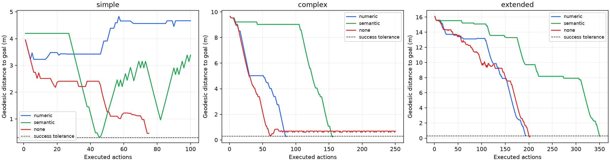

# OpenAI Decisions 两轮导航消融审计

来源：`runs/openai-decisions-{simple,complex,extended}-rgbgs-{numeric,semantic,none}-20261009-{01,02}`，共 18 轮真实模型记录。实际响应模型均为 `openai/gpt-6-luna-decisions-20261006`。

共 8/18 成功（44.4%），6/18 成功且零碰撞（33.3%）；3028 个动作、290 次碰撞、26 个无效动作。每类只有一个固定任务，百分比仅描述这批记录。

## 逐条件指标

每个条件两轮的请求正文、逐步动作、位姿和目标距离完全相同。因此下表用一行展示两轮相同的导航指标；CSV 保留全部 18 行。响应 ID 全部唯一（3028 个），运行创建时间及耗时不同；日志支持它们是两次独立请求过程，不能仅凭此判断服务确定性、缓存或底层采样设置。

| 路线 | 输入 | 成功数 | 结果 | 动作数 | 碰撞 | 无效动作 | 累计路程 m | 最终距离 m | SPL |
|---|---|---:|---|---:|---:|---:|---:|---:|---:|
| 简单路线 | [数值深度](../../runs/openai-decisions-simple-rgbgs-numeric-20261009-01/summary.json) | 0/2 | 失败：预算耗尽 | 100 | 5 | 0 | 5.559 | 4.667272 | 0.000 |
| 简单路线 | [语义深度](../../runs/openai-decisions-simple-rgbgs-semantic-20261009-01/summary.json) | 0/2 | 失败：预算耗尽 | 100 | 10 | 1 | 17.609 | 3.388045 | 0.000 |
| 简单路线 | [无深度](../../runs/openai-decisions-simple-rgbgs-none-20261009-01/summary.json) | 0/2 | 失败：提前停止 | 75 | 17 | 0 | 6.918 | 0.462650 | 0.000 |
| 复杂路线 | [数值深度](../../runs/openai-decisions-complex-rgbgs-numeric-20261009-01/summary.json) | 2/2 | 成功 | 86 | 0 | 0 | 12.000 | 0.278290 | 0.816 |
| 复杂路线 | [语义深度](../../runs/openai-decisions-complex-rgbgs-semantic-20261009-01/summary.json) | 2/2 | 成功 | 156 | 0 | 9 | 11.750 | 0.241567 | 0.834 |
| 复杂路线 | [无深度](../../runs/openai-decisions-complex-rgbgs-none-20261009-01/summary.json) | 0/2 | 失败：预算耗尽 | 250 | 106 | 0 | 31.390 | 0.689694 | 0.000 |
| 长路线 | [数值深度](../../runs/openai-decisions-extended-rgbgs-numeric-20261009-01/summary.json) | 0/2 | 失败：提前停止 | 194 | 0 | 0 | 20.500 | 0.308222 | 0.000 |
| 长路线 | [语义深度](../../runs/openai-decisions-extended-rgbgs-semantic-20261009-01/summary.json) | 2/2 | 成功 | 351 | 0 | 3 | 19.750 | 0.261363 | 0.826 |
| 长路线 | [无深度](../../runs/openai-decisions-extended-rgbgs-none-20261009-01/summary.json) | 2/2 | 成功 | 202 | 7 | 0 | 28.071 | 0.173495 | 0.581 |

## 失败和效率观察

- 简单数值：最小距离 3.227464 m（第 4 动作），之后逐渐偏离；62 次左转、2 次右转、17 次后退，末尾连续 9 次左转且无平移。第 7 动作目标 bearing=-28.80°（右侧），却左转，后续多次左转继续扩大方向偏差。说明此次跟随/恢复行为失败，不能把它全部解释为终点停止问题。
- 简单语义：第 45 动作距目标 0.332596 m，尚未进入容差；第 46 动作继续前进至 0.335350 m，第 47–51 动作继续远离。初始目标在右侧，执行连续左转；整轮 25 次左转而没有右转，最终预算耗尽。
- 简单无深度：停止请求中目标距离 0.463 m，真实 NavMesh 距离 0.462650 m，明确超过 0.30 m；此前有 17 次碰撞，属于容差外提前停止。
- 复杂数值：86 动作、零碰撞、零无效动作。复杂语义也成功且零碰撞，但 156 动作；46 次俯仰动作及 62 次左转造成更高动作成本，9 个无效动作全部为超俯仰范围（6 次抬头、3 次低头）。语义路程略短不等于动作效率更高。
- 复杂无深度：第 61 动作最接近至 0.322039 m，但未进入成功范围；终点附近反复前进/后退并受阻，累计 106 次碰撞，末尾仍在约 0.60–0.69 m 往返。
- 长数值：零碰撞并基本完成跟随，但在 0.308222 m 停止，距成功阈值仅多 8.22 mm。请求明确给出 0.308 m，因此不是显示四舍五入或欧氏/路径距离不同引起的合规停止，按既定评估应记失败。
- 长语义：351 动作成功且零碰撞，累计路程 19.750 m，接近 19.613 m 的参考路径；228 次左转、43 次俯仰动作，运动路径较短但动作/时间成本高。
- 长无深度：202 动作成功，但 7 次碰撞，路程 28.071 m，SPL 0.581，低于长语义的 0.826。不能把较少动作直接等同于避障能力更好。

以上左转倾向是日志观察，尚不能区分模型方向理解、提示词/候选顺序偏好、深度条件或服务设置的因果作用；没有据此修改策略。所有失败均未曾进入 0.30 m 成功范围。

## 与此前 Jev 相同任务比较

同一七动作 v5 提示词、参考路径、起终点及初始姿态，共同配置一致，仅模型/输入模式/渲染 GPU 等实验字段不同。逐模式的初始请求正文去掉 model 后核查相同。Jev 历史组包含可比失败记录，复杂数值有 3 次，其余 2 次；历史运行时间不同，且部分回放使用 mesh RGB，RGB 均不发给模型。

| 路线 | 输入 | Jev 成功/运行 | OpenAI 成功/运行 |
|---|---|---:|---:|
| 简单路线 | 数值深度 | 2/2 | 0/2 |
| 简单路线 | 语义深度 | 2/2 | 0/2 |
| 简单路线 | 无深度 | 2/2 | 0/2 |
| 复杂路线 | 数值深度 | 1/3 | 2/2 |
| 复杂路线 | 语义深度 | 1/2 | 2/2 |
| 复杂路线 | 无深度 | 1/2 | 0/2 |
| 长路线 | 数值深度 | 1/2 | 0/2 |
| 长路线 | 语义深度 | 0/2 | 2/2 |
| 长路线 | 无深度 | 0/2 | 2/2 |

OpenAI 在这两个有深度的复杂任务条件、长路线语义条件上完成得更好；简单路线明显退步。长数值的失败主要落在停止边界，不能简单说整体跟随能力差。无深度长路线虽成功，仍不能声称具备可靠避障。单个任务和两次完全相同轨迹不支持一般性能排名。

## 请求延迟（秒）

| 路线 | 输入 | 第一轮 P50/P95 | 第二轮 P50/P95 |
|---|---|---:|---:|
| 简单路线 | 数值深度 | 1.359/1.521 | 1.470/2.999 |
| 简单路线 | 语义深度 | 1.336/1.508 | 1.485/2.764 |
| 简单路线 | 无深度 | 1.352/1.491 | 1.467/3.185 |
| 复杂路线 | 数值深度 | 1.361/1.484 | 1.443/1.838 |
| 复杂路线 | 语义深度 | 1.377/1.556 | 1.484/2.524 |
| 复杂路线 | 无深度 | 1.372/1.586 | 1.473/2.951 |
| 长路线 | 数值深度 | 1.352/1.543 | 1.467/2.475 |
| 长路线 | 语义深度 | 1.331/1.491 | 1.486/2.604 |
| 长路线 | 无深度 | 1.314/1.465 | 1.497/2.925 |

第二轮 P50 普遍约 1.44–1.50 s，第一轮约 1.31–1.38 s；导航相同但 API 端到端延迟不同。这里不是纯模型计算耗时，也不能由此推断整个闭环实时能力。

## 实验与核查边界

- 简单/复杂/长路线最短距离约 4.196/9.798/16.323 m，参考长度 4.196/11.711/19.613 m；动作预算 100/250/500。成功需模型输出 stop 且 NavMesh 距离 ≤0.30 m。保留原阈值，不将近成功改记成功。
- 有深度条件使用 mesh 深度，GS RGB 仅供回放；无深度仍有参考路线、目标、本体状态、最近自身动作反馈，属于当前策略的深度输入消融。
- 碰撞是 Habitat NavMesh 移动过滤 collided；无效动作含超俯仰限制。累计路程包括往返，不计原地旋转/观察。SPL 使用原最短距离而非安全余量参考路径长度。
- 已重算全部 3028 个动作的 NavMesh 距离、累计路程、碰撞/无效计数、停止成功条件和 SPL；核查三种实际输入、模型身份、步序、位姿连续性、逐条件与 Jev 的初始输入及提示词一致性。原始文件哈希保持不变。没有重新渲染、调用 API、修改导航代码或重跑实验。
- [18 轮完整 CSV](runs.csv)、[聚合 CSV](aggregate.csv)、[Jev 对照 CSV](jev-comparison.csv)、[结构化审计及源哈希](audit.json)、[复核脚本](audit.py)。
